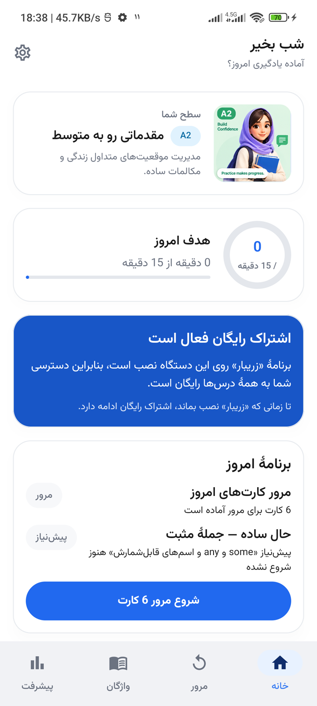
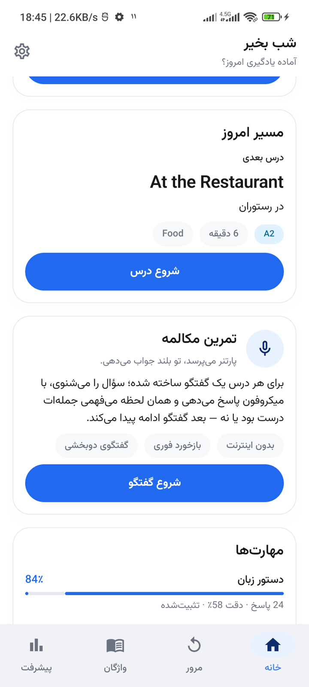
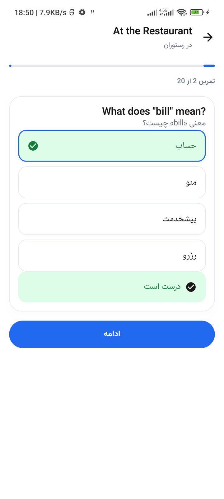
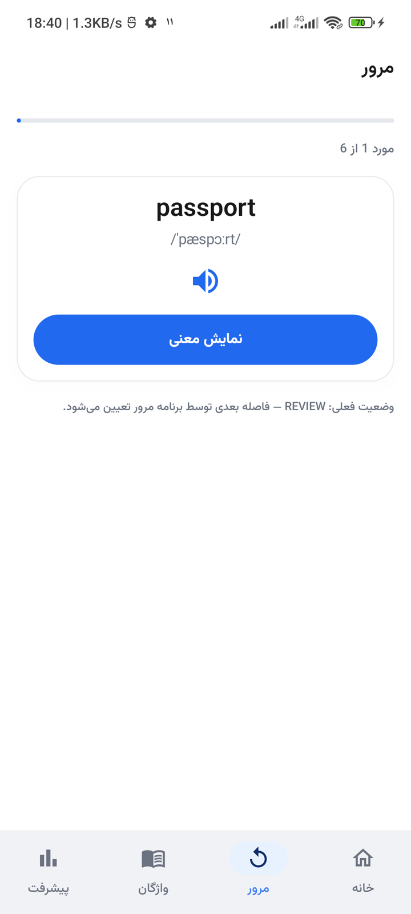
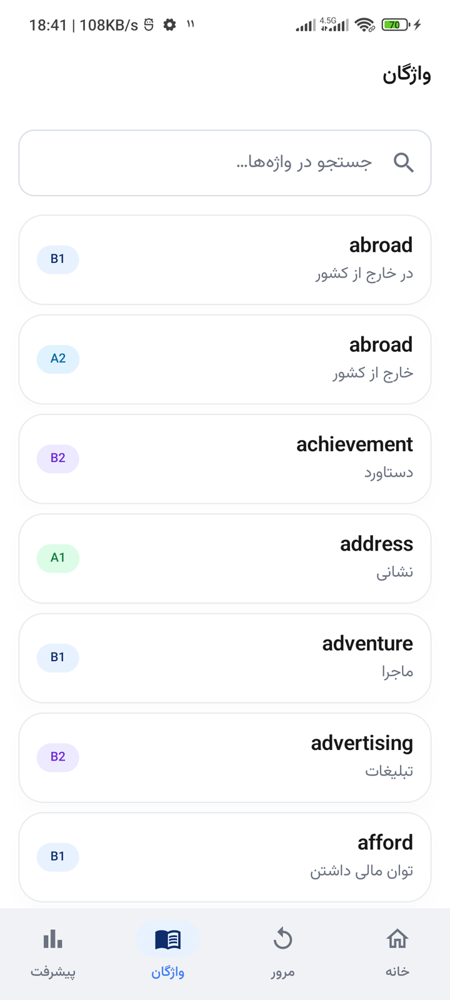
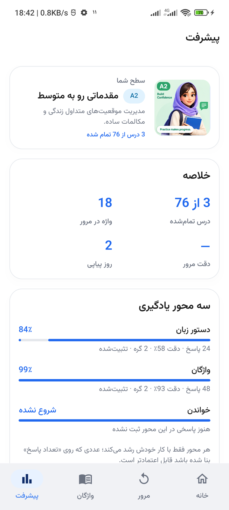
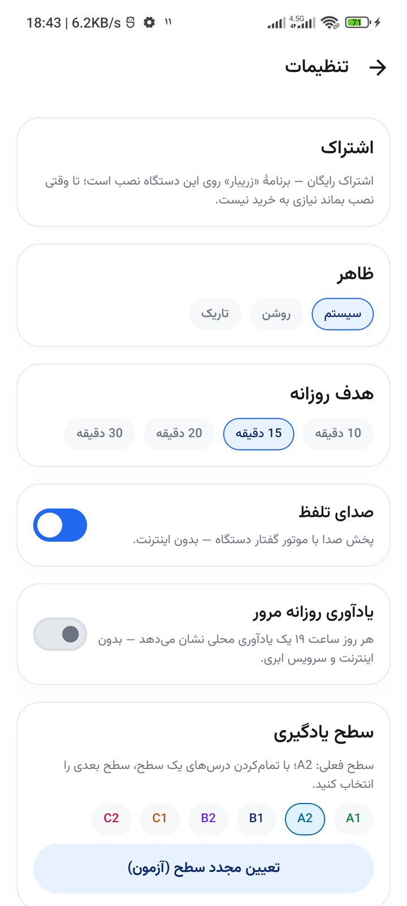

# Lingo — English Learning (A1–C2)

[](https://github.com/syedmohdbarzgar/lingo/actions/workflows/ci.yml)

> اپ اندروید **آفلاین‌محور** برای فارسی‌زبانانی که انگلیسی یاد می‌گیرند:
> درسِ قدم‌به‌قدم (هشت مرحله) → تمرین → گفت‌وگوی همان درس، که درس بعد را باز می‌کند
> → مرور فاصله‌دار → پیشرفت. هستهٔ یادگیری کامل روی دستگاه کار می‌کند و بدون اینترنت
> هم باید کار کند؛ نمره‌دهی گفتار هم با مدل روی دستگاه انجام می‌شود.

An offline-first Android app for Persian speakers learning English (CEFR A1–C2): an eight-step
guided lesson → exercises → that lesson's own conversation (spoken, or typed; it is what opens the next
lesson) → spaced-repetition review → progress. Every one of the 180 syllabus topics ships, and
the speech practice is graded on the device by a recogniser, not by a server.

| | |
|---|---|
| Gradle project | `Lingo` |
| Application id | `org.token.english` |
| Display name | Lingo |
| Min / target / compile SDK | 24 / 37 / 37 |
| Language & UI | Kotlin + Jetpack Compose (forced RTL) |
| Local storage | Room (schema v10, exported) + DataStore Preferences |

The learner UI is entirely Persian; all English content is rendered through components that
re-assert LTR, because the root layout is forced RTL.

---

## Contents

- [What is in the app today](#what-is-in-the-app-today)
- [Screenshots](#screenshots)
- [Build and run](#build-and-run)
- [Project layout](#project-layout)
- [Content pipeline](#content-pipeline)
- [Testing](#testing)
- [Connectivity](#connectivity)
- [Known limitations](#known-limitations)
- [Roadmap](#roadmap)
- [Contributing](#contributing)
- [Documentation](#documentation)
- [License](#license)

---

## What is in the app today

**Learning flow**

- **Placement test** — 36 questions in six graded bands of six (A1→C2), including one reading
  comprehension item per band so the test measures reading alongside grammar and vocabulary (A-6)
  and one typed fill-in-the-blank in the A1 band, so production is sampled alongside recognition.
  Scoring is band-based: a
  band passes at ≥ 2/3 with ≥ 60 % cumulative accuracy, scoring stops at the first failed band, and
  the result floors at A1. It doubles as a per-skill assessment (P1-1): each question carries an authored skill, so the result screen shows a per-skill read and the placement answers calibrate the learner's skill profile from day one.
- **Foundations first** — the alphabet and letter names, spelling your name, and numbers 0–100 are the
  first three A1 lessons, so a complete beginner meets letters before words. Greetings now sits
  behind the alphabet in the curriculum graph.
- **Lessons** — one active stage at a time, in eight steps: context and objective → grammar →
  vocabulary → controlled practice → listening (optional, skipped explicitly on a device without an
  English voice) → writing → speaking → review and assessment. The stage rail and the header's
  percentage show only *completed required* steps, so a skip never reads as progress, and the
  lesson resumes on the step the learner left. The plan is derived from each lesson's own content,
  so no lesson needed re-authoring. A wrong answer shows a short explanation and re-asks that same
  item once in the same session, so a miss is never just a score.
- **The lesson's own conversation** — every lesson carries a dialogue in the situation it teaches
  (a hotel desk, a policy review, an editing workshop) with the partner's line, its Persian gloss
  and graded replies. It runs on the conversation screen with the on-device recogniser: the learner
  speaks, the take is scored `CORRECT` / `NEAR` / `RETRY` against the accepted answers, and the
  grammar the recogniser listens for is built from those answers, so what it can hear matches what
  the content asks for. Nothing leaves the device. A finished lesson is **not** complete until this
  dialogue has been walked to its last turn — the next lesson stays shut until then, because the
  conversation is where the learner produces what the exercises only tested.
- **Exercises** — `multiple_choice`, `fill_blank`, `word_recall`, `translation`,
  `sentence_production`, `listening`. Multiple-choice options are shuffled deterministically per
  question id (fixed seed), so the answer position never leaks. `word_recall` names the English word
  from its Persian meaning with no options to recognize, and `sentence_production` makes the learner
  build the whole sentence — graded on the target structure (ordered anchors plus a word floor), so
  an original correct sentence is not failed for phrasing it differently. A `speaking` item *inside*
  the lesson's stage session is shadowing: the on-device TTS speaks the model, the learner records a
  take, plays it back and compares, then moves on. The graded speaking lives in the lesson's
  dialogue, on the conversation screen (above), where the recogniser returns a verdict.
- **Review** — SM-2-lite spaced repetition with a daily new-card cap (20) and calendar-day anchors
  instead of raw 24-hour multiples. Odd-numbered cards ask for active production: a Persian prompt,
  typed English answer. `AGAIN` re-queues inside the session (at most twice).
- **Listening** — read aloud by the on-device Android TTS engine. No audio files, no network.
- **Vocabulary browser** — search with escaped `LIKE` patterns.
- **Progress** — three independent skill tracks (Grammar, Vocabulary, Reading), each with its
  mastery, the evidence behind it and a status; plus streaks, review accuracy, knowledge-node
  coverage, and an error taxonomy that reads the recent answers and says what the misses were
  *about* (vocabulary, grammar, comprehension, production) and which one to fix first.
- **Daily reminder** — inexact daily alarm; asks for `POST_NOTIFICATIONS` on Android 13+.

**Learner model**

Mastery is tracked twice, on purpose, and both use the same engines:

- per **skill** (vocabulary, grammar, listening, speaking, reading, writing) — an exponentially
  weighted average, seeded by the first observation;
- per **knowledge item** — 268 curriculum nodes carrying prerequisites, mastery, exposure counts and
  their own review schedule. `KnowledgeGraph` orders and unlocks the graph; every graded lesson
  answer is attributed to the nodes its lesson teaches and written with an atomic
  read-modify-write.

`DefaultKnowledgeEngine` reuses the same SM-2 scheduler for intervals/ease and the same mastery
engine as the skill meters, so "known" cannot mean two different things in two screens.

On the Progress screen those per-skill numbers are grouped into the three axes the app can actually
teach and act on — Grammar, Vocabulary and Reading — each shown with the evidence behind it (how many
answers, how accurate, how many curriculum nodes) rather than as a bare percentage. Listening,
speaking and writing are still not bars of their own: nothing in the bundle answers to them *alone*.
They are no longer unwritten, though — a spoken conversation turn moves `SPEAKING`, a typed one and
every `sentence_production` move `WRITING`, so the numbers now exist behind the scenes even though
the screen chooses not to show a meter that a single format could fill.

An answer is counted once. `question_attempt` (Room v9) stores the day's answer per exercise and
`claimAnswer` guards every write, so re-answering the question just answered — a retry, or a re-run
of the lesson — moves neither mastery nor the streak; the claim is per *exercise*, so a remediation
block's several questions still each count. And a lesson is only «مسلط» when the nodes it teaches
need no more practice today, which is a different claim from its steps being finished.

What that claim deliberately does *not* keep is the answer itself, so the session records it: every
graded answer is appended to `lesson_attempt` (which step asked it, what was typed or picked, right or
wrong, when), and each finished step stamps its completion time. A lesson interrupted mid-step
therefore reopens on the first question of that step it has **no** answer for — the saved cursor says
how far, the log says what was actually done — and a lesson from before the log keeps its saved
cursor instead of pretending it starts over.

**Content bundle (JSON `contentVersion` 64)**

| | Count |
|---|---|
| Lessons | 192 — A1: 37, A2: 32, B1: 30, B2: 32, C1: 31, C2: 30 |
| Exercises | 3147 — including a dialogue in every lesson (five or six turns at A2 and above) and a real reading passage with two or more comprehension questions in **36** lessons (six per level) |
| Vocabulary entries | 1154 |
| Knowledge items | 268 |
| Placement questions | 36 |

The syllabus behind those numbers is the 180 topics (30 per CEFR band) in
[`docs/curriculum.md`](docs/curriculum.md) — **all 180 ship as of v60**, so new material now means
deepening a lesson rather than opening a topic. The C2 pass that produced v61 is recorded in
[`docs/review-c2.md`](docs/review-c2.md): what was checked, what it found, and the ready-to-author
items that would bring the four thinnest C2 lessons up to the standard. The v63 pass went the other
way and **deepened** existing material instead of opening topics: a reading passage with two
comprehension questions in five lessons per level (35 → 95 READING items in 43 lessons — 84 of
them built on a shared passage in 36 lessons, 11 single-sentence meaning items across 7 more), and a
`skill` tag on the last 147 exercises that had none, so every answer now moves a track and the
bundle ships no untagged item at all.

The v64 pass audited the result rather than adding to it, and is recorded in
[`docs/review-v64.md`](docs/review-v64.md): the measured skill split (READING 3.3%, WRITING 0.1%
of the bundle), seven real defects fixed — an item whose question spelled its own answer, a
listening pair shipped twice, a production model under the item's own word floor, two recall
questions already asked at A1, and three A2 examples repeating their A1 sentence — and seven new
rules in `validateContent` so each class of defect blocks a build. `node scripts/content_audit.mjs`
reprints every number behind that report.

The bundle is authored data only: extending it needs **no Kotlin change**, just JSON plus a bump of
`contentVersion`, which is declared inside the files themselves.

**Subscription**

All content is subscription-gated from the first launch — there is **no free trial**; plans are
`sub_monthly` and `sub_yearly`. Access is decided by a pure, unit-tested `EntitlementPolicy`
(SUBSCRIPTION → COMPANION_APP → LOCKED). Each release build targets one market and embeds only
that market's billing SDK:

| Flavour | Store | SDK |
|---|---|---|
| `bazaar` | کافه‌بازار | Poolakey 2.2.0 (real subscriptions) |
| `myket` | مایکت | myket-billing-client 1.19 (Myket has no subscriptions — plans are consumables with a local expiry) |
| `googlePlay` | Google Play | Play Billing 9.1.0 |

A subscription's validity is mirrored locally from the store's answer with a 32-day grace, so a
short offline spell never locks a paying learner out; the store stays the source of truth.

**Free with the Zaribar app:** while the companion app `org.token.zaribar` is installed, the
subscription is free — the grant is re-checked on every foreground and ends when the companion is
removed. The install is trusted only when its signing certificate matches
`CompanionApp.EXPECTED_SIGNING_SHA256` (the package id alone would be spoofable). While the grant is
active the app states the free access and **shows no download button** — the companion is already on
the device. The Cafe Bazaar link (`bazaar://details?id=org.token.zaribar`) belongs to the
not-installed state, where the paywall, the Settings subscription card and Home's free-route card all
name the free route; **one pure rule decides that** — `CompanionOffer.isOffered`, so the offer can
never come back on a device that already has the companion. The check is a single local `PackageManager` lookup: no server, no permission,
and it is declared in the manifest `<queries>` block for API 30+ visibility.

---

## Screenshots

Captured from the running app (Bazaar debug, light theme, Persian RTL) on a 1080×2400 device and
downscaled to 720 px wide. They are the real screens, not mockups — what you see is what the
bundled content and the learner model produced on that install.

| Home | Lesson (intro) | Lesson (feedback) |
|---|---|---|
|  |  |  |

| Review | Vocabulary | Progress |
|---|---|---|
|  |  |  |

| Settings |
|---|
|  |

The original design mockups are kept in `files/` as design intent; the built UI follows them through
the shared design-system tokens rather than by copying pixels. The brand board is
[`lingua_english_learning_brand_board.png`](files/stitch_english_learning_app_design_system/lingua_english_learning_brand_board.png/screen.png).

---

## Build and run

The everyday loop is **tests, not APKs**. Compiling all three flavours after every change is slow
and buys nothing — do it at release points or when putting a build on a device.

### Requirements

- **JDK 25** — the version the project is verified against. Gradle runs on the JVM you launch it
  with; the foojay toolchain resolver in `settings.gradle.kts` can provision a missing toolchain.
- **Android SDK** with platform **37** and matching build-tools, plus `platform-tools` for ADB.
  Point the build at it with `sdk.dir` in an untracked `local.properties`.
- **No local Gradle install** — always use the wrapper (`./gradlew`), which pins Gradle 9.6.0.
- A device or emulator is only needed for instrumented tests or manual UI checks; the unit-test gate
  runs on the JVM alone.
- Optional: `keystore.properties` for release signing and the marketplace billing keys.

```bash
# Fast gate: unit tests, and a typecheck of the main sources that comes for free.
./gradlew :app:testBazaarDebugUnitTest

# Content gate: validates every bundled JSON file (also runs in preBuild).
./gradlew validateContent

# Offline speech model for conversation practice — not committed (~40 MB), fetched once.
# Re-runnable; `--force` re-downloads. Without it the app still builds, but the
# practice screen can only report the missing model.
bash scripts/fetch_vosk_model.sh
```

Only per-flavour unit-test tasks exist (`testDebugUnitTest` is not a task under AGP 9's
`onlyEnableUnitTestForTheTestedBuildType`).

**On a real device** — builds and installs only when a device is actually attached, and exits
quietly with no build when none is:

```bash
scripts/install_debug.sh                 # bazaar (default); or myket | googlePlay
scripts/install_debug.sh --list-devices
```

**Release points**

```bash
./gradlew :app:assembleBazaarDebug      # Cafe Bazaar APK
./gradlew :app:assembleMyketDebug       # Myket APK
./gradlew :app:assembleGooglePlayDebug  # Google Play APK
```

**CI** (`.github/workflows/ci.yml`) runs three jobs on every push and pull request:
**`verify`** (content validation + unit tests + the B-9 `runCatching` grep), **`transactions`** (the
atomic-evidence classes, filtered out of the same suite) and **`lint`** (`lintBazaarDebug`). The
`transactions` job proves every multi-write learner flow — lesson answer, review grade, conversation
turn, lesson completion, placement calibration — commits as one Room transaction, and fails if a new
use case does not. **`assemble`** (the three flavor APKs) and **`device`** (one emulator boot running
`scripts/verify_device.sh` — install, airplane mode on, two timed cold starts, seed line, crash sweep)
run only on a schedule, a manual dispatch or a tag, and wait for `transactions`, because building
every flavor or booting an emulator on every commit buys nothing. `device` passes `--require-device`,
so an emulator that never came up fails the job instead of passing as a no-op; it is a launch smoke,
not an instrumented suite.

### Toolchain

Verified October 2026 — do not "fix" these casually:

- AGP **9.5.0** + Gradle **9.6.0**, JDK toolchain **25** (Kotlin falls back to JVM 24 target).
- **Built-in Kotlin** (AGP 9 default): never apply `org.jetbrains.kotlin.android`.
- KSP `2.2.10-2.0.2` must match the built-in KGP `2.2.10`; `composeCompiler` must equal the built-in
  Kotlin version too.
- `android.disallowKotlinSourceSets=false` in `gradle.properties` is required for KSP's generated
  sources under built-in Kotlin.
- Only per-flavour build types are enabled for unit tests, as noted above.

### Release signing

`keystore.properties` is **untracked and must stay that way**. It holds
`storeFile`/`storePassword`/`keyAlias`/`keyPassword` plus the marketplace keys `bazaarRsaKey` and
`myketPublicKey`. A Cafe Bazaar release build **fails deliberately** when `bazaarRsaKey` is empty,
because Poolakey would otherwise silently run with signature verification disabled.

---

## Project layout

```
app/src/main/java/org/token/english
├── MainActivity.kt              Compose host: theme gate + forced RTL root
├── EnglishApp.kt                Application → AppContainer, seeding and reminder ticks
├── navigation/                  Routes + NavHost + bottom bar
├── core/
│   ├── designsystem/            Colour/type/shape/spacing tokens + shared components
│   ├── billing/                 BillingGateway, EntitlementPolicy (pure), SubscriptionMath
│   ├── audio/                   AudioPlayer interface + on-device TTS implementation
│   └── common/                  TimeUtil (day keys, streaks), SafeCatching
├── domain/                      PURE KOTLIN — no Android, no Room, no Compose
│   ├── model/                   Lesson, VocabularyItem, Exercise, KnowledgeItem, AnswerChecker
│   ├── repository/              Repository interfaces (implemented in data/)
│   ├── engine/                  ReviewScheduler, MasteryEngine, LearningPlanner, LessonMastery,
│   │                            KnowledgeGraph, KnowledgeEngine, KnowledgeEvidence
│   └── usecase/                 SubmitExercise, CompleteLesson, SubmitReview, GetTodayPlan, …
├── data/
│   ├── local/                   Room: entities, DAOs, AppDatabase (v10, schemas exported)
│   ├── content/                 ContentParser (org.json) + ContentSeeder (assets → Room)
│   └── repository/              Repository implementations + SettingsRepositoryImpl (DataStore)
├── di/AppContainer.kt           Manual DI container
└── feature/<screen>/            Screen + ViewModel per feature, incl. paywall/
app/src/{bazaar,myket,googlePlay}/java/org/token/english/billing/PlatformBillingGateway.kt
```

### Dependency rule

```
feature → domain (models + usecases) + core/designsystem + di
domain  → nothing Android (pure Kotlin only)
data    → domain (implements the interfaces) + Room/DataStore
```

- UI state is always `UiState (StateFlow) ← Event ← ViewModel ← UseCase/Repository`. ViewModels never
  touch Room or DataStore directly, and composables contain no business logic.
- DI is manual (`AppContainer`). Hilt was deliberately skipped — its plugin/KSP interaction under
  AGP 9's built-in Kotlin adds risk for no MVP value.
- A ViewModel takes only the repositories, use cases and seams it actually uses — never the whole
  container. `di/ViewModelFactories.kt` is the single place the container meets a ViewModel, and the
  only `di/` symbol a screen imports is its own `*ViewModelFactory()` (B-6). Narrow constructors are
  what make ViewModel tests possible without Android.
- Engines are pure and swappable. The UI must never learn how intervals or mastery are computed.

### How a screen gets its data

```
Composable (feature/<screen>/…Screen.kt)
      │  emits Events
      ▼
ViewModel  ── StateFlow<UiState> ──▶ recomposition (state is the single source of truth)
      │  calls use cases / repositories
      ▼
domain/usecase ──▶ domain/engine   (pure: ReviewScheduler, MasteryEngine,
      │                             LearningPlanner, KnowledgeGraph, KnowledgeEngine)
      ▼
domain/repository (interfaces)
      │  implemented by
      ▼
data/repository ──▶ Room (local) + DataStore (preferences)   ← the whole learning core
      │
      └─▶ core/billing BillingGateway → the flavour's PlatformBillingGateway → store SDK
                                                                            (the only network path)
```

---

## Content pipeline

Source of truth: `app/src/main/assets/content/`

| File | Defines |
|---|---|
| `lessons.json` | Lessons, CEFR level, order, Persian grammar tip |
| `vocabulary.json` | Words, translation, IPA, two bilingual {en, fa} examples each, collocations |
| `exercises.json` | The exercises (authored JSON payloads) |
| `placement.json` | The banded placement questions |
| `knowledge.json` | The curriculum graph: nodes, prerequisites, taught lessons, skills |

`ContentSeeder` runs at app start and re-seeds only when the JSON `contentVersion` differs from the
stored one; the clear-and-insert runs in a single Room transaction, so a crash can never leave a
half-seeded database. A seed that fails anyway is **not silent**: `AppContainer` records the outcome
in `ContentStatus`, and Home shows a card naming the failure with a «تلاش دوباره» button instead of
an empty screen a fresh install cannot explain. The same `ContentStatus` is why no screen sits on a
spinner forever — Home, Progress, Vocabulary, Review and Settings each separate `loading` from
`failed`, and a failed load renders an explanation with a retry, not a bare empty state.

`./gradlew validateContent` is the gate, and runs before every build. The JSON pipeline cannot see
content mistakes at compile time, so without it a dangling `lessonId` silently orphans a lesson, an
out-of-range `correctIndex` only throws mid-lesson, and a duplicate id is dropped by Room without a
word. The task checks ids, references, CEFR levels, exercise types, answer keys, blank markers,
non-empty accepted answers, duplicate words within a lesson, bundle-version agreement, full lesson
coverage, and that the prerequisite graph has **no cycles**. It reports every problem at once rather
than stopping at the first.

Adding content is therefore JSON only. Correct-answer positions are kept balanced across the option
slots by `scripts/balance_answer_positions.mjs`, and `ContentDistributionTest` enforces it.

---

## Testing

```bash
./gradlew :app:testBazaarDebugUnitTest
```

760 unit tests across 81 classes. The pure cores carry the most weight — review scheduling,
mastery and answer checking, streak day keys, entitlement policy and subscription math, placement scoring
and its per-skill assessment, the content pipeline, the curriculum graph and the knowledge engine —
and every decision engine (planner, prerequisites, remediation, mastery profile, exercise selector,
miss taxonomy) has its own tests. `LearningPathJourneyTest` runs the whole learner journey on the real bundle with
in-memory repositories, so the pieces are proven to compose, not just to work alone. The first
ViewModel tests (B-6) drive `Home`/`Lesson`/`Review` through in-memory fakes — companion gating, the
requeue-once-on-a-miss rule, the TTS-unavailable fallback and the review lifecycle — with no
Android, no Room and no device. `Paywall`, `Settings` and `Placement` are covered the same way: a
billing double makes the unpayable paths (unpriced products, unreachable store, cancelled, failed
and restored purchases) testable, and placement is proven to stop as soon as a band becomes
unwinnable instead of asking a beginner all 36 questions. The adaptive layer runs on real screens too (B-1): Home shows the
remediation engine's weak spot and its CTA opens a focused session that drills only the exercises
which are evidence about that node, while every session orders its queue by the kind of knowing the
learner's own answers showed to be weakest.

Progress is reported as three separate skill tracks — Grammar, Vocabulary and Reading — instead of
one blended number, because a strong vocabulary says nothing about whether the past tense landed.
`SkillProfileEngine` (pure) reads the persisted per-skill mastery, the curriculum side (how often a
node was practised and how often it lapsed) and the review history, one profile per axis, and never
recomputes mastery itself — so the EWMA stays single-source. The status is deliberately
evidence-gated: nothing answered is `NOT_STARTED`, fewer than five answers is `BUILDING`, and only
past that does mastery separate `CONSOLIDATING` from `CONSOLIDATED`. Checking mastery first would be
wrong, since a first correct answer seeds mastery at 1.0 and would read as consolidated. Home and
Progress render the same composable, so the two screens can never disagree. `SkillProfileEngineTest`
proves all of it on the real bundle, including the four curriculum nodes that genuinely belong to two
tracks at once (asserted exhaustively, so new content cannot quietly change the split).

An upgrading install is covered as well as a fresh one: `RoomMigrationTest` checks the migration SQL
against the exported schemas, and `DatabaseUpgradeTest` runs that same chain on a real SQLite engine
against a v1 database already full of learner data — progress, the review schedule, skill mastery,
study time — then proves every value survived, that the columns added since carry their documented
defaults, and that the curriculum-graph tables arrive ready and empty. A destructive or forgotten
migration therefore fails the build instead of wiping a learner's history on update.

The remediation layer is evaluated on that same real bundle rather than on hand-built fixtures.
`RemediationJourneyTest` misses a real lesson's grammar drills and asserts the engine offers a block
for exactly that node and runs it in that node's own lesson; that error isolation holds (the lesson's
pronunciation node is untouched, because it only listens for listening evidence); that a foundational
weakness reports the real number of nodes it is holding back; and that answering the block correctly
closes it — at **one bar** the plan and the engine now share. Those two used to disagree: the plan
dropped the block at 0.5 while the engine only called the node fixed at 0.85, from a session profile
that seeded an untouched dimension at 1.0 on a first correct answer. `RemediationEngine`'s reassess
bar now equals the weakness bar and its verdict reads the node's **stored** mastery, so a first
correct answer no longer fixes a weak node.

The two retrieval/production shapes are covered from both ends. `ProductionRecallTest` pins the
grading rules — recall keeps the one-edit spelling hint, and production credits an original sentence
but rejects one whose anchors are out of order, below the word floor, or a filler that merely carries
the anchors without reusing the target sentence (the structural branch also requires reusing half of
an authored exemplar) — while `ProductionRecallContentTest` checks the authored bundle: every item
parses, the cue is Persian and the answers English, both shapes exist at all six levels, and each
item's anchors are proven to credit its own exemplar (asserted with the accepted answers replaced by
a decoy the answer cannot exact-match, so only the structural rule can pass it — asking the item as
authored would be vacuous, since an exemplar match short-circuits it).

Content tests read the assets through `File`, so Gradle cannot see them as inputs — after a content
edit run them with `--rerun`, or they silently report `UP-TO-DATE`.

There is no instrumented suite — the Android Studio template was removed rather than kept as a
false signal. UI changes rely on manual verification on a device, or on
[`scripts/verify_device.sh`](scripts/verify_device.sh) for the install-and-launch half.

---

## Connectivity

The app is **offline-first, not offline-only**. The learning core runs entirely from Room and
DataStore and must keep working with no network at all. `INTERNET` is currently used only by in-app
billing, and the only network code paths are the billing SDKs.

Suspended — needs backend/server infrastructure, not just connectivity:

- AI conversation / AI feedback
- Cloud sync, authentication, backup
- Downloadable content packages
- Analytics upload

Allowed but not built yet: remote crash reporting. On-device speech evaluation **is** built — the
conversation screen grades each spoken turn with the bundled Vosk model, offline, and the model file
is fetched once by `scripts/fetch_vosk_model.sh` rather than committed. The same window also accepts
a **typed** answer, because the recogniser needs a downloaded model and a working microphone: without
one the conversation — and with it the next lesson — used to be unreachable. Typed answers go through
the same `ConversationScorer` gate, so the verdict means the same thing either way.

Any new online feature must state which service it calls and why, must degrade gracefully when
offline, and must not block the learning core.

---

## Known limitations

- **Myket has no real subscriptions.** Expiry is local and lost on reinstall; a user claiming a lost
  subscription must re-prove the purchase through support.
- `bazaarRsaKey` unset disables Poolakey verification — release builds refuse to ship in that state.
- Persian UI strings live inline in composables; extracting them to `strings.xml` is open design
  debt until a second locale appears.
- Room is at `version = 10` with exported schemas in `app/schemas`. Schema changes must ship a
  migration; the container registers `AppDatabase.ALL_MIGRATIONS` wholesale, because a hand-picked
  list once omitted a step and crashed **upgrading** installs at open time while fresh installs
  stayed green.
- Due counts are read stale-on-open by design: Home re-reads them on a minute ticker but rebuilds only
  when the number changes, and the review summary re-reads on resume (never mid-session). A queue that
  grows while the screen is continuously visible waits for the next visit.
- Study time is credited by an interaction-based ticker (30-second samples, stopped after 4 minutes of
  idling), not merely for having the app open — see [`docs/learner-model.md`](docs/learner-model.md).
- A streak day requires at least 60 seconds of study.
- Single `:app` module; split it when build times or ownership demand it.

---

## Roadmap

Nothing here is committed to a date; it is the order in which the pieces make sense.

**Buildable offline (no backend required)**

- Finish moving the spaced-repetition queue onto the knowledge graph. Both directions now exist: a
  review grade **feeds the reviewed word's node** — mastery and that node's own next review date,
  inside the card's transaction, and never an exercise-format confirmation (a card is recall, not
  transfer; see [`docs/debt.md`](docs/debt.md)) — and a due **node** is re-served through its own
  exercises, listed on the review screen and opened as the focused drill — one tap into its own
  drill, not into a whole lesson. What is still missing is the reverse *convenience*: a node's
  exercises are not queued **as cards** (a card carries no exercise to grade, so the queue and the
  graph stay two lists).
- Finish the error taxonomy. The classification shipped: `MissTaxonomy` labels every recent lesson
  answer by the skill its exercise is authored for (vocabulary, grammar, comprehension, production)
  and every review card by its content type (vocabulary or grammar — a card knows nothing finer),
  and Progress shows the pooled mix and the category carrying the most misses. **The mix now steers**
  both places that decide what to do next: the day's plan orders within one priority by the weakest
  category and names the gap, and the review screen's due list breaks ties the same way (equally
  overdue nodes, weakest first). Difficulty is now authored too (v66): every exercise carries a
  `difficulty` (1–3, relative to its own lesson’s level) and the selector uses it to come down to the
  easy end while a dimension is shaky and up to the hard end once it is consolidated. What the plan
  still cannot do is pick a harder **lesson** — a lesson carries no difficulty of its own
  ([`docs/debt.md`](docs/debt.md)).
- A `writing` exercise type (the exercise model already has room for it). Conversation shipped as
  its own screen rather than an exercise type, because it needs a turn, a partner and a verdict.- Pronunciation scoring, deeper than the verdict. The lesson's `speaking` item goes through the same
  offline recogniser as the dialogue (a said-back take is graded, `NEAR` counts, `RETRY` claims
  nothing), the same capture is kept as audio so the learner hears exactly the words that were
  judged — on the lesson's card **and** on every dialogue turn, which offers its own recording back
  under the transcript — and the verdict now comes with **word-level feedback**: the take is marked
  against the model sentence and the content words the device did not hear are named (
  [`docs/debt.md`](debt.md)). What is still missing is the sound rather than the word: a take is
  matched, not *scored*, so «نزدیک» never means a phoneme was wrong and no mark says a word was said
  badly. That needs a different engine — phoneme-level scoring, or a cloud service the connectivity
  policy keeps suspended.
- Remote crash reporting — a deliberate provider and privacy decision, not a default.

**Suspended until a backend exists**

AI conversation and feedback, cloud sync / authentication / backup, downloadable content packages,
and analytics upload. [`AGENTS.md`](AGENTS.md) §4 explains the reasoning and the seams already left
in place for each.

**Infrastructure**

- Deeper device coverage. The `device` job now proves launch, seeding and a second cold start on an
  emulator, but it stops there: no instrumented suite exists, so per-screen behaviour, the upgrade
  path from an installed older build, the recogniser (mic) and the splash transition still need a real
  phone via `scripts/verify_device.sh` and the manual pass in [`docs/testing.md`](docs/testing.md).

---

## Contributing

[`AGENTS.md`](AGENTS.md) is the authoritative reference — read it before changing anything. The
short version:

- **Run the gates locally.** CI runs them too, but a red pipeline is a slow way to learn:
  `./gradlew :app:testBazaarDebugUnitTest`, and `./gradlew validateContent` after any content edit.
- **Content is data, not code.** Add lessons, words, exercises and knowledge nodes in the JSON
  bundle and bump `contentVersion`; new content needs no Kotlin change.
- **Respect the layers.** `domain/` stays pure Kotlin (no Android, no Room, no Compose), and the UI
  never learns how intervals or mastery are computed.
- **Use the design tokens.** Never hardcode colours, spacings or radii; Persian strings live inline
  in composables and English text goes through the LTR components.
- **Offline stays sacred.** The learning core must keep working with no network, and anything that
  needs a backend must be confirmed with the maintainer before it is built.
- A change is done when the tests pass, `validateContent` passes if content moved, empty, loading
  and error states exist, RTL/LTR is verified, and no undocumented permission was added.

---

## Documentation

- [`AGENTS.md`](AGENTS.md) — the authoritative reference for anyone (human or agent) working on this
  repository: architecture, conventions, the connectivity policy and the definition of done.
- `files/` — the source design and methodology specs (design system, CEFR curriculum methodology,
  target technical architecture). Treat them as design intent, not proof of implementation.

## License

The bundled **Vazirmatn** font is licensed under the SIL Open Font License — see
[`licenses/Vazirmatn-OFL.txt`](licenses/Vazirmatn-OFL.txt). No license has been chosen for the
application source code in this repository yet.
